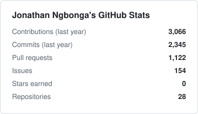
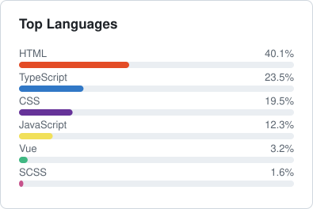

## Hi there 👋 I'm Jonathan

### 👨‍💻 What I use

### 📊 GitHub stats

  <picture>
    <source media="(prefers-color-scheme: dark)" srcset="assets/stats-dark.svg">
    
  </picture>
  <picture>
    <source media="(prefers-color-scheme: dark)" srcset="assets/langs-dark.svg">
    
  </picture>

  <picture>
    <source media="(prefers-color-scheme: dark)" srcset="https://streak-stats.demolab.com?user=jongbonga&theme=dark&hide_border=true">
    
  </picture>

